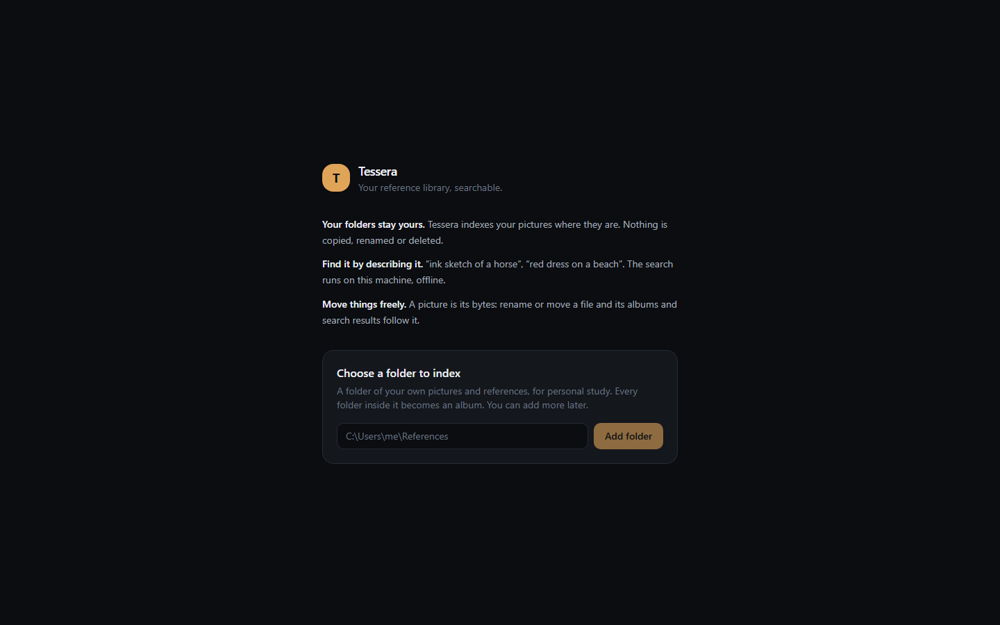
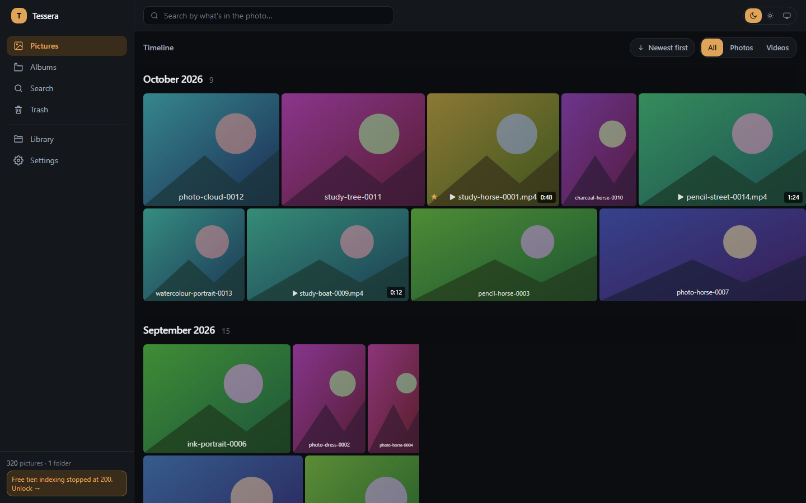
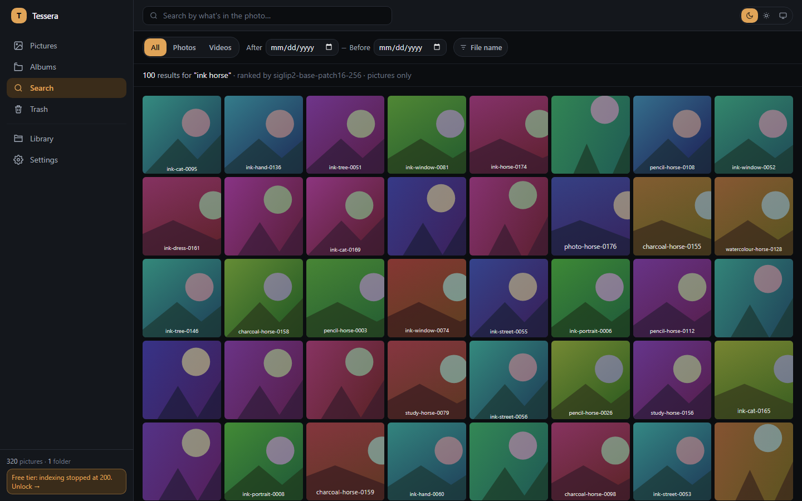
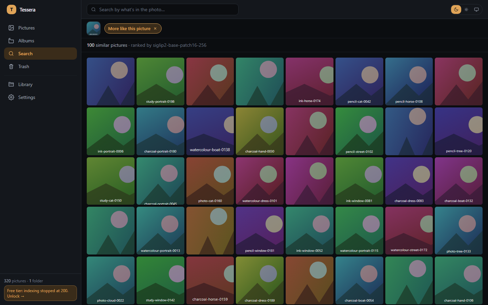
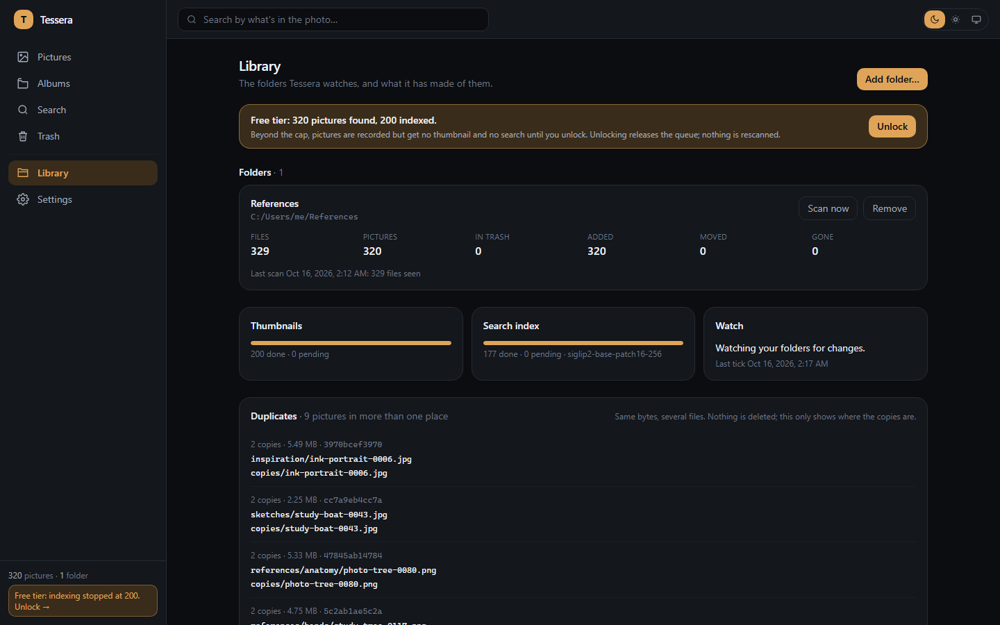
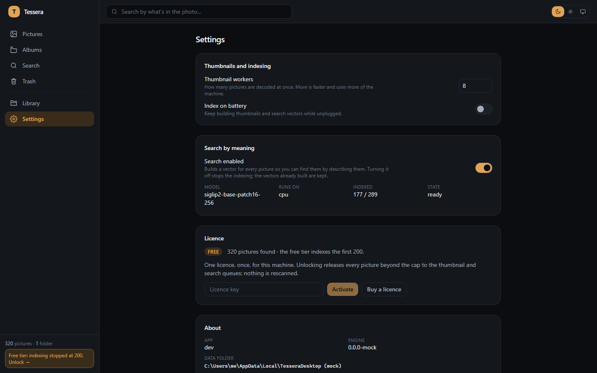

# web — the Tessera Desktop UI

The React app the Tauri shell shows. It talks to one thing: the local core
(`tessera-core`) on a loopback port, with a per-launch token. Pictures, albums,
search, trash, the Library page, settings, the licence. No accounts, no login,
no network of its own.

| | |
|---|---|
| Stack | React 19, TanStack Router and Query, Tailwind 4, Vite, Vitest |
| Builds to | `web/dist`, bundled by the shell (`pnpm --dir web build`) |
| Talks to | the core's `/api` (contract §3 and §4) and `/health/ready`; the shell's commands (§5) |
| Owner | the web session; nothing outside `web/` is edited from here |

## Run it against the mock

The core is another session's work. `mock/server.mjs` stands in for it:
every route the app calls, fake pictures, a scan that takes a few seconds, a
model download that takes ten, and the free-tier cap.

```bash
pnpm install
cp .env.example .env.local     # VITE_CORE_URL / VITE_CORE_TOKEN, matching the mock
pnpm mock                      # http://127.0.0.1:2501, state in mock/.state.json
pnpm dev                       # http://localhost:5173
```

First run: onboarding asks for a folder. Any path that looks like one works
(`C:\Users\me\References`); the mock "finds" 320 pictures in six folders. To
start over: `MOCK_RESET=1 pnpm mock`.

| Mock knob | Default | Meaning |
|---|---|---|
| `MOCK_PORT` | 2501 | port |
| `MOCK_TOKEN` | the one in `.env.example` | the bearer / `sessionKey` |
| `MOCK_CAP` | 200 | free-tier cap, small so one folder reaches it |
| `MOCK_ASSETS` | 320 | pictures per folder |
| `MOCK_RESET=1` | | forget the saved state |
| `MOCK_STDIN_EOF=1` | | exit when stdin closes, as the real core does |

Thumbnails and originals are coloured SVGs with the file name on them.
Pictures past the cap get a 404 for their thumbnail until the licence is set
to `licensed` (the Settings page does this outside Tauri with any key of
eight characters or more).

## Check it

```bash
pnpm test        # vitest: the core resolver, the client's auth, onboarding, Library
pnpm typecheck
pnpm build       # typecheck + vite build → dist/
```

## How it is wired in Tauri

Boot, in `src/app/AppBoot.tsx`:

1. `src/shared/api/core.ts` finds the core. Inside Tauri
   (`window.__TAURI_INTERNALS__`) it calls `invoke('core_info')` and gets
   `{ baseUrl, token }`. Outside, it reads `VITE_CORE_URL` and
   `VITE_CORE_TOKEN`.
2. `src/shared/api/client.ts` keeps both. Every `/api` request goes through
   `apiJson` in `tessera.ts`, which prefixes the origin and sends
   `Authorization: Bearer <token>`. Image and video URLs get
   `?sessionKey=<token>` instead, because `` cannot send headers.
3. The app polls `GET /health/ready` once a second and shows "Starting the
   engine" until it answers 200. Then the router mounts.
4. The router's layout route reads `GET /api/library`; no roots means
   `/welcome` (onboarding).

The shell's other commands are wrapped in `src/shared/api/shell.ts`, each
with a browser fallback: `pick_folder` (a path text field), `licence_get`,
`licence_activate` (outside Tauri: sets the core's licence directly so the
flow can be walked against the mock), `open_external` (a new tab),
`app_version` ("dev").

The Vite dev server is fixed to port 5173, the origin the core allows with
`TESSERA_DEV=1`.

## What is where

| Folder | Does |
|---|---|
| `src/app` | boot screen, router, shell (sidebar, search box), query client |
| `src/shared/api` | `core.ts` (where the core is), `client.ts` (token, media URLs), `tessera.ts` (JSON + `ApiError`), `types.ts` (every shape the core sends), `timeline.ts`, `queries.ts`, `shell.ts` |
| `features/timeline` | the grid: months as buckets, virtualised, justified rows |
| `features/viewer` | full-screen viewer; info panel with name, path, size, albums; "More like this" |
| `features/albums` | folders as albums plus manual ones; list, detail, rename, delete, cover pick from the album's own pictures, same-name badge |
| `features/search` | by meaning (the core's local model), by file name, "more like this"; shows the model's progress on a 503 |
| `features/selection` | multi-select: favourite, add to album, trash |
| `features/trash` | hidden pictures; restore only |
| `features/library` | the Library page: folders, counts, scans, queues, watch, duplicates, the cap banner; the hooks for the core's own routes |
| `features/onboarding` | first run |
| `features/settings` | settings, search toggle, version, data dir, licence |
| `mock` | the stand-in core |
| `docs` | screenshots against the mock |

## Screenshots (against the mock)

| | |
|---|---|
|  |  |
|  |  |
|  |  |

## Rules it keeps

- Nothing is ever deleted. Trash is a mark; "Restore all" is the only way out
  of it. Removing a folder from the library says so in the dialog.
- A file's identity is its hash. Media URLs are by id; the core derives the
  thumbnail path from the hash.
- Status is numbers. Scans say seen/added/moved/gone/errors; queues say
  pending/done; the cap banner says found and indexed.
- One network use is visible from here: the model download. The licence
  check and the update feed are the shell's.

## Not done

- **Cover pick persistence needs the core.** The picker sends
  `albumThumbnailAssetId` on `PATCH /api/albums/{id}` (Immich's own
  `UpdateAlbumDto` field). The fork's PATCH only read `albumName` and
  `description`; until the core honours the field the choice is shown
  optimistically and lost on refetch. The mock honours it.
- Not tried in Tauri. The `invoke` wrappers follow contract §5 exactly, but
  the first real launch is the shell session's to make; expect small
  argument-name fixes.
- No videos in the mock (its originals are SVGs), so the viewer's video path
  is untested here.
- Search results are one ranked list, up to 500. No paging; "Show up to 500"
  raises the limit once.
- The grid still fetches thumbhashes the core does not produce yet (null
  today); tiles show a flat surface until the thumbnail arrives.
- Save-a-copy in the viewer uses a plain `<a download>`; in the Tauri webview
  that may open the file instead of saving it.
- No dark/light screenshots of every page; the theme toggle is in the header.
